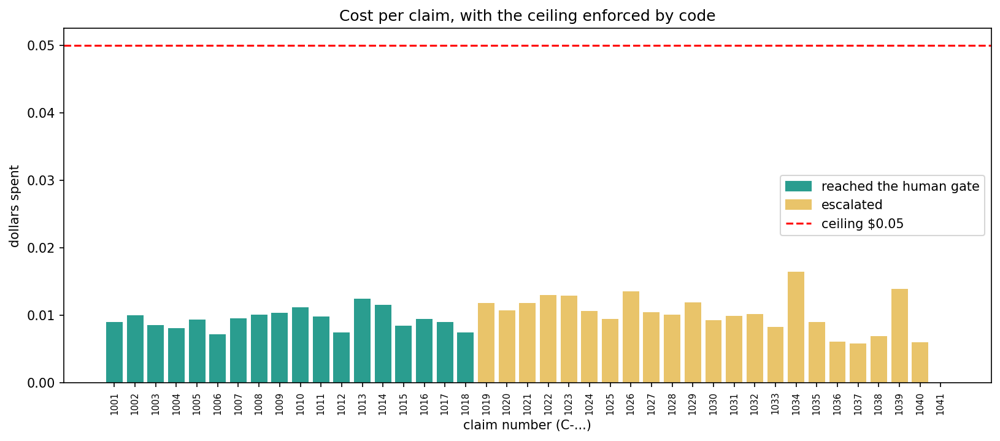

# Casefile: multi-agent claims orchestration

A small system that processes auto insurance claims with four coordinated parts: a **supervisor** and three specialists (**extractor**, **investigator**, **reviewer**). It is built so that it always stops, never spends past a ceiling, can be replayed, and never writes a payout recommendation to the claims system without a human approving it.

The point of the project is the boundaries around the agents, not the agents themselves: termination conditions, loop guards, cost ceilings, typed handoffs, observability and replay.

## Results

All numbers come from a run of 41 synthetic claims against the Cohere model `command-a-plus-05-2026`.

| Ship gate item | Evidence |
|---|---|
| 30+ recorded runs, each with a trace of the exact node path | 41 runs, 41 traces, every trace path matches the run's recorded path (`ship_gate.py`) |
| A run replayed from a stored snapshot reaches the same terminal state | 8 replays across 2 claims, rewinding to every checkpoint; all reach an identical final state with zero live AI calls (`replay.py`) |
| The reviewer sends work back at least once and the graph still terminates | 15 of 41 runs had a send-back; all ended in a terminal state |
| Cost per claim charted, ceiling enforced by code | Average $0.0097, maximum $0.0165, ceiling $0.05, 0 claims over (`cost_per_claim.png`) |
| No payout recommendation written without a human | No write-back happened for any batch claim; the write function refuses without a valid approval (`tests/test_approval.py`) |

Every one of the 41 claims ended in the outcome predicted for its scenario:

| Scenario | Count | Expected outcome |
|---|---|---|
| clean | 18 | paused at the human approval gate |
| inflated estimate | 8 | escalated to a human |
| over the policy limit | 4 | escalated |
| duplicate of an existing claim | 3 | escalated |
| line items do not add up | 3 | escalated |
| unknown policy | 2 | escalated |
| messy / unreadable | 2 | escalated |
| oversized (built to trip the pre-call budget check) | 1 | escalated |

The test suite has 47 tests.



### Example trace

One claim with an inflated estimate. The reviewer asks for more evidence, the investigator goes deeper, and the reviewer then hands the claim to a human. Only the AI steps cost money.

```
claim C-2001  ->  ESCALATED  (reviewer escalated)
   1. extractor     tokens=837   dollars=0.006391
   2. investigator  tokens=0     dollars=0.0
   3. reviewer      tokens=629   dollars=0.002012
   4. investigator  tokens=0     dollars=0.0
   5. reviewer      tokens=730   dollars=0.002528
   total: 2196 tokens, $0.01093
```

## How it stops: the guards

The supervisor is plain code with no AI in it. Before every step it checks the guards below, then decides who runs next. A tripped guard is a valid ending, not an error: the run finishes as `ESCALATED` with a reason a human can read.

| Guard | Rule | Stop reason |
|---|---|---|
| Step cap | at most 12 steps per claim | `step cap reached` |
| Budget cap | 50,000 tokens and $0.05 per claim | `budget cap reached` |
| Pre-call budget check | before each AI call, assume the worst case (estimated input plus the maximum reply) and refuse the call if it could pass the ceiling | `<agent> failed: next call could go over the budget` |
| Send-back cap | the reviewer may send work back at most 2 times | `send-back cap reached` |
| Stuck check | the same node may not run twice in a row | `stuck: same agent ran twice in a row` |
| Agent failure | any agent error (bad schema, bad tool input, cut-off reply, unknown policy) ends the run safely | `<agent> failed: <reason>` |

Terminal and resting states: `AWAITING_APPROVAL` (paused for a human), `DONE`, `REJECTED`, `ESCALATED`.

## How it works

```
        SUPERVISOR  (deterministic router, not an LLM)
   +------------+-----------+-----------+
   v            v           v           |
EXTRACTOR  INVESTIGATOR  REVIEWER ---(send back, capped)--> INVESTIGATOR
                            |
                  HUMAN APPROVAL GATE --> write-back to the claims system
```

- **Extractor (AI):** reads the raw claim text and returns JSON that must pass a schema check. Anything invalid, chatty or cut off escalates. Bad data never travels on.
- **Investigator (plain code and tools):** looks up the policy, prior claims and a repair-cost benchmark through contract-checked tools, then sets flags: over the policy limit, more than 1.5x the typical repair cost, or another claim on the same policy on the same day. After a send-back it uses the reviewer's reason to add detailed notes.
- **Reviewer (AI, with code that overrules it):** judges the claim and returns `APPROVE_RECOMMEND`, `SEND_BACK` (with a reason from a fixed list) or `ESCALATE`. Plain rules then have the last word: if the line items do not add up to the total, or if the AI approves a claim flagged as over the limit or a suspected duplicate, the verdict becomes `ESCALATE`.
- **Approval gate:** the run pauses with its state saved. Only an explicit approve or reject record resumes it.

### Design decisions

- **Facts from code, judgment from AI.** Limits, prior claims and benchmarks come from tool lookups, so they cannot be invented. The AI is used only where judgment is needed.
- **Typed handoffs.** Agents exchange validated Pydantic models and fixed enums, never free text. Each agent writes only its own slice of the shared state, and the control fields (step count, budget, send-back count) belong to the supervisor.
- **One door for each dangerous thing.** All tool calls go through `call_tool`, which checks the input contract. All writes to the claims system go through `write_back`, which checks the approval inside the function: the approval must exist, be for this claim, say "approve", and not have been used before. One-time use is enforced by a database primary key, so two simultaneous requests cannot both succeed.
- **The AI proposes, the code decides.** Replies are checked before they enter the state, and a few hard rules can overrule the reviewer.
- **State survives restarts.** A snapshot is saved after every step, including the counters the guards depend on, so a resumed run cannot reset a loop guard.
- **Observability around the agents, not inside them.** OpenTelemetry spans wrap the loop: one span per claim and one per step, with tokens, dollars and any error recorded on each.

## Replay

Every AI reply is recorded during the batch (`RecordingLLM`). A replay loads a stored snapshot, then serves the recorded replies (`ReplayLLM`) instead of calling the model, so it costs nothing and cannot contact the AI provider.

`replay.py` rewinds a claim to each of its checkpoints and plays forward again. Every replay reaches the same final state, including status, path, tokens and dollars.

**What this proves:** the orchestration code (supervisor, guards, state handling, tools) is deterministic given the same AI answers.
**What it does not prove:** that the AI gives the same answers on a fresh run. It may not.

## Project layout

```
agents/          extractor, investigator, reviewer
graph/           supervisor (router and guards), runner (loop and tracing), approval_gate
schemas/         enums, claim, investigation, review, state
tools/           tool contracts and the single call_tool door
store/           snapshots, approvals, a stand-in claims system (SQLite)
llm/             model client, budget accounting, record and replay
observability/   OpenTelemetry setup
data/            fake policies, prior claims, repair benchmarks, 41 generated claims
tests/           47 tests
config.py        step, token, dollar and send-back limits
make_claims.py   builds the 41 synthetic claims (seeded, repeatable)
run_batch.py     runs all claims, records replies and traces
replay.py        replays claims from stored snapshots
chart_costs.py   draws cost_per_claim.png
ship_gate.py     checks every ship-gate item
```

## Run it

Python 3.10 or newer.

```bash
pip install pydantic cohere opentelemetry-sdk matplotlib pytest
```

Set your key for the current terminal (PowerShell shown) and fill in the two price lines in `config.py` from your provider's pricing page.

```powershell
$env:CO_API_KEY="your-key"
python -m pytest -v
python make_claims.py
python run_batch.py
python replay.py
python chart_costs.py
python ship_gate.py
```

`run_batch.py` can be stopped and restarted. It skips claims that already finished. About 90 model calls are made, and the whole batch cost under 50 cents.

## What this is, and what it is not

- **The data is synthetic.** The claims are generated, and the policies, prior claims and benchmarks are small fake tables. The claim mix (18 clean, 23 problem cases) is made to exercise the guards, not to resemble a real book of business.
- **The investigator has no AI in it, on purpose.** Its checks are plain rules. Making it an AI agent that chooses its own tools is a reasonable extension, and the tool contracts are already written for it.
- **SQLite stands in for Postgres or Redis.** All database code sits in the `store/` folder, so swapping is a contained change.
- **The state machine is hand-rolled** rather than built on LangGraph, to keep every guard visible.
- **The claims system is a stub**, and the approval gate is a function, not a user interface. There is no login or role check on who may approve.
- **The budget pre-check uses a rough estimate** of about 4 characters per token. It only has to be safe, because real usage is recorded after each call and the supervisor's budget guard catches anything that slips past.
- **Scale is not tested.** At the measured average of about $0.0097 per claim, 900 claims a day would cost roughly $9 a day in model calls. That is arithmetic from a synthetic mix, not a forecast.

## Problems found along the way

- **A cut-off reply looks like a broken reply.** Early on, the extractor failed with a JSON error. The cause was that the model's reply had hit the output-token limit and stopped mid-way. The fix was to record why the model stopped and treat a cut-off reply as its own error, so the stop reason says what really happened.
- **A check that always printed zero.** The first version of the replay script reported that no saved replies were served, even though replays were clearly running. The script read a counter from an object that the run itself had already changed. Reading the value before the run fixed it.
